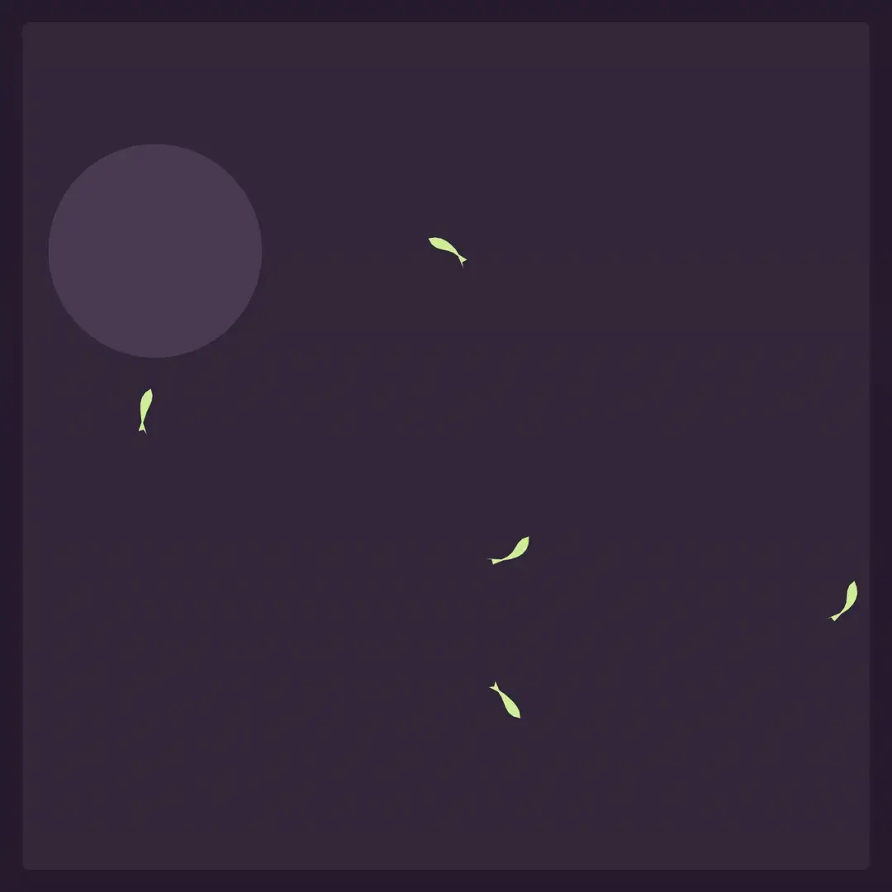

# animacy

[animacy](https://gustavecortal.com/animacy/) is a tiny autoregressive transformer, trained on trajectories of fish and flies, that samples each next step from a Gaussian mixture. This repository prepares the data, trains the models and exports them for the live demo.

<p align="center">
  <a href="https://gustavecortal.com/animacy/"></a>
</p>

## Quick start

```bash
git clone https://github.com/gustavecortal/animacy.git
cd animacy
uv run animacy rollout fish
```

This writes `out/fish.gif`: 20 seconds of 10 fish moved by the model of the live demo, in about 15 seconds on a CPU. The GIF shows the model alone, without the page's rocks, food or predator. `flies` and `both` work the same way.

## How it works

Each token is an animal's step over 1/30 s, and the transformer predicts the next one as a mixture of five Gaussians, from which it is sampled. The animal also sees its 16 nearest neighbours: their direction, distance and last step. The recordings are [idtracker.ai](https://idtracker.ai/)'s, about 100 hours of zebrafish and 60 of fruit flies.

## Rebuild the models

```bash
uv run animacy fetch fish
uv run animacy build fish
uv run animacy train fish
uv run animacy export fish
```

`fetch` downloads the recordings (474 MB for fish) from idtracker.ai's Google Drive. If Drive reports a used-up quota, run it again later. `train` takes about 45 minutes on a GPU, and `export` writes the model to `exports/fish/`.

## License

The code is under the [MIT license](LICENSE). The recordings come from [Torrents, Costa and de Polavieja (2026)](https://doi.org/10.7554/eLife.107602) and are not in this repository.
