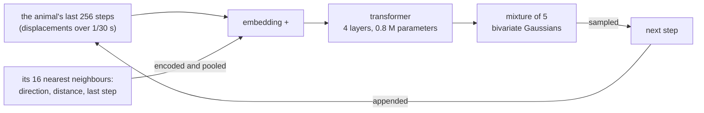

# animacy

[animacy](https://gustavecortal.com/animacy/) is a tiny autoregressive transformer, trained on trajectories of fish and flies, that samples each next step from a Gaussian mixture. The trajectories are idtracker.ai recordings of zebrafish and fruit flies. The model generates the collective motion of a group step by step. This repository prepares the data, trains the models and exports them for the live demo, which runs them in the browser.

<p align="center">
  <a href="https://gustavecortal.com/animacy/"></a>
</p>

## Quick start

With [uv](https://docs.astral.sh/uv/getting-started/installation/), which installs Python and PyTorch on the first run:

```bash
git clone https://github.com/gustavecortal/animacy.git
cd animacy
uv run animacy rollout fish
uv run pytest
```

`rollout` writes `out/fish.gif`: 20 seconds of 10 fish moved by the shipped model in `exports/fish/`. It takes about 15 seconds on a desktop CPU, after a minute or so on the first run while uv installs Python 3.11 or later and PyTorch. Each fish starts by swimming straight to a random point, so no recordings are needed. The GIF shows the model alone, as dots on white: the page's rocks, food, walls and predator are not in it. `flies` and `both` work the same way. `pytest` checks, without recordings, that the shipped models give the live page's outputs.

## How it works



A trajectory is read like text. Each token is an animal's displacement over 1/30 s, and a decoder-only transformer predicts the next one as a mixture of five bivariate Gaussians, from which the step is sampled. Each of the animal's 16 nearest neighbours is described by its direction, log distance and last step. A small network encodes each one, and a softmax over their scores pools them into one vector, added to the embedding of the animal's step.

The recordings are idtracker.ai's: about 100 hours of fish and 60 of fruit flies. A position is kept only where the tracker measured it and human validation left it unchanged. Each run of positions is low-pass filtered, resampled to 30 Hz and divided by the frame's longer side. Recordings that may film the same animals share a group, and a seeded split holds out one group of each species for validation and one for testing, each at most a tenth of the hours. For the flies and the pooled model, each recording is rescaled so that its animals have the same body length, as idtracker.ai estimates it, since the cameras film them at different zooms.

Each model is trained in three stages, each from the last one's weights: 3,000 steps alone, 2,000 seeing its neighbours, and 2,000 more. With negative log-likelihood alone, simulated schools drifted apart, so the stages with neighbours add the squared error of the mixture's mean step. At export, each attention head keeps the shortest window, of 16 to 256 steps, that holds 90% of its attention, so the browser computes less. The page's rocks, food, walls and predator are browser rules that act on the model's proposed moves. They are not in this repository.

| File | Contents |
|---|---|
| [`src/animacy/data.py`](src/animacy/data.py) | Download, checks, observed positions and split groups of the recordings |
| [`src/animacy/sessions.json`](src/animacy/sessions.json) | The SHA-256 of every file the models were trained on |
| [`src/animacy/corpus.py`](src/animacy/corpus.py) | Filtering, resampling to 30 Hz and the split |
| [`src/animacy/scenes.py`](src/animacy/scenes.py) | Every animal of a recording on one clock, with what it could see of the others |
| [`src/animacy/model.py`](src/animacy/model.py) | The transformer, its neighbour encoder and the mixture |
| [`src/animacy/train.py`](src/animacy/train.py) | Training |
| [`src/animacy/configs.py`](src/animacy/configs.py) | The three models: their data, training stages, head windows and temperature |
| [`src/animacy/export.py`](src/animacy/export.py) | `model.json`, `weights.bin`, parity fixtures and recorded starts for the page |
| [`src/animacy/rollout.py`](src/animacy/rollout.py) | A school moved by an exported model, from a synthetic or a recorded start |
| [`exports/`](exports) | The three models of the live page, as `model.json` and `weights.bin` |

## Rebuild the models

```bash
uv run animacy fetch fish
uv run animacy build fish
uv run animacy train fish
uv run animacy export fish
```

`fetch` downloads the 17 fish recordings (474 MB) from [idtracker.ai](https://idtracker.ai/)'s public Google Drive folder into `data/sessions/`, and checks each file against the one the models were trained on. Drive limits how often a file is downloaded. If `fetch` reports a used-up quota, run it again later: it keeps the files it already has. `flies` has 8 recordings (301 MB), and `both` uses all of them. `build` turns them into the training corpus in about half a minute on a desktop CPU. Then `uv run animacy rollout fish --recorded` continues a held-out school of 10 fish instead of a synthetic one.

`train` runs the three stages into `runs/fish/` (`--steps 4` checks the setup in seconds), each step on 512 windows of 256 steps. Each stage of the shipped models took about 15 minutes on an Intel Arc A770. Training runs on a CUDA, Intel or Apple GPU when PyTorch finds one. It also runs on the CPU, but far slower. PyTorch from PyPI uses CUDA on Linux only: elsewhere, install [the build for your GPU](https://pytorch.org/get-started/locally/) into `.venv` and run with `uv run --no-sync`. A rerun on a GPU may not give the shipped weights bit for bit.

`export` writes `model.json` and `weights.bin` to `exports/fish/`, with the head windows of `configs.py`, and checks that the weights reload exactly. `model.json` records the hashes of the corpus files the model was trained on, which `build` reproduces. It also writes `fixtures.json`, outputs the page checks its own implementation against, and `seeds.json`, the page's recorded starts. Both hold excerpts of the recordings, so they are not in this repository.

## License

The code is under the [MIT license](LICENSE). The recordings are not in this repository: `fetch` downloads them from the authors' folder, which states no terms of use. They come from [Torrents, Costa and de Polavieja (2026)](https://doi.org/10.7554/eLife.107602), whose article is under CC BY 4.0. The weights in `exports/` were trained on them.
