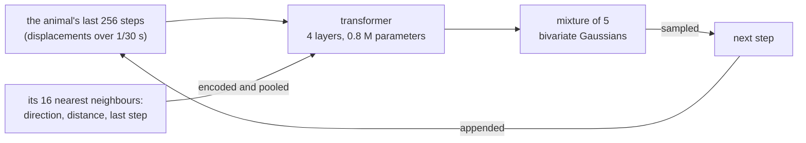

# animacy

[animacy](https://gustavecortal.com/animacy/) is a tiny autoregressive transformer, trained on trajectories of fish and flies, that samples each next step from a Gaussian mixture. The [live demo](https://gustavecortal.com/animacy/) runs it in the browser, and this repository prepares its data, trains it and exports it for the page.

<p align="center">
  <a href="https://gustavecortal.com/animacy/"></a>
</p>

## Quick start

With [uv](https://docs.astral.sh/uv/getting-started/installation/), which installs Python and PyTorch on the first run:

```bash
git clone https://github.com/gustavecortal/animacy.git
cd animacy
uv run animacy fetch fish
uv run animacy build fish
uv run animacy rollout fish
```

`fetch` downloads the 17 fish recordings (474 MB) from [idtracker.ai](https://idtracker.ai/)'s public Google Drive folder into `data/sessions/`, and checks each file against the one the models were trained on. Drive limits how often a file is downloaded: if `fetch` reports a used-up quota, run it again later, and it keeps the files it already has. `build` turns them into the training corpus in about a minute on a desktop CPU. `rollout` writes `out/fish.gif`, the shipped model in `exports/fish/` continuing a held-out school of 10 fish for 20 seconds, in a few seconds on the CPU.

`flies` (8 recordings, 301 MB) and `both` work the same way. `uv run pytest` checks, without any download, that the shipped models give the live page's outputs.

## How it works



A trajectory is read like text. Each token is an animal's displacement over 1/30 s, and a decoder-only transformer predicts the next one as a mixture of five bivariate Gaussians, from which the step is sampled. Each of the animal's 16 nearest neighbours is described by its direction, log distance and last step. A small network encodes each one, and a softmax over their scores pools them into the animal's input.

The recordings are idtracker.ai's: about 100 hours of fish and 60 of fruit flies. A position is kept only where the tracker measured it and human validation left it unchanged. Each run of positions is low-pass filtered, resampled to 30 Hz and divided by the frame's longer side. Recordings that may film the same animals share a group, and a seeded split holds out about one group in ten for validation and one for testing. For the flies and the pooled model, each recording is rescaled so that its animals have the same body length, as idtracker.ai estimates it, since the cameras film them at different zooms.

Each model is trained in three stages, each from the last one's weights: 3,000 steps alone, 2,000 seeing its neighbours, and 2,000 more. With negative log-likelihood alone, simulated schools drifted apart, so the stages with neighbours add the squared error of the mixture's mean step. At export, each attention head keeps only the last 16 to 256 steps it attends to, which the browser computes faster. The rocks, food, walls and predator of the page are rules in the browser that act on the model's proposed moves, and are not part of this repository.

| File | Contents |
|---|---|
| [`src/animacy/data.py`](src/animacy/data.py) | Download, checks, observed positions and split groups of the recordings |
| [`src/animacy/sessions.json`](src/animacy/sessions.json) | The SHA-256 of every file the models were trained on |
| [`src/animacy/corpus.py`](src/animacy/corpus.py) | Filtering, resampling to 30 Hz and the split |
| [`src/animacy/scenes.py`](src/animacy/scenes.py) | Every animal of a recording on one clock, with what it could see of the others |
| [`src/animacy/model.py`](src/animacy/model.py) | The transformer, its neighbour encoder and the mixture |
| [`src/animacy/train.py`](src/animacy/train.py) | Training |
| [`src/animacy/configs.py`](src/animacy/configs.py) | The three models: their data, training stages, head windows and temperature |
| [`src/animacy/export.py`](src/animacy/export.py) | `model.json`, `weights.bin`, parity fixtures and recorded starts for the page |
| [`src/animacy/rollout.py`](src/animacy/rollout.py) | A held-out school continued by an exported model |
| [`exports/`](exports) | The three models of the live page |

## Rebuild the models

```bash
uv run animacy train fish
uv run animacy export fish
```

`train` runs the three stages into `runs/fish/`, each step on 512 windows of 256 steps. The shipped models took about 40 minutes each on an Intel Arc A770. Training runs on a CUDA, Intel or Apple GPU when PyTorch finds one, and on the CPU otherwise, many times slower. PyTorch from PyPI uses CUDA on Linux only: elsewhere, install [the build for your GPU](https://pytorch.org/get-started/locally/) into `.venv` and run with `uv run --no-sync`. A rerun on a GPU may not give the shipped weights bit for bit.

`export` writes `model.json`, `weights.bin`, `fixtures.json` and `seeds.json` to `exports/fish/`, with the head windows of `configs.py`, and checks that the weights reload exactly. `model.json` records the hashes of the corpus files the model was trained on, which `build` reproduces.

## License

The code is under the [MIT license](LICENSE). The recordings are not in this repository: `fetch` downloads them from the authors' folder, which states no terms of use. They come from [Torrents, Costa and de Polavieja (2026)](https://doi.org/10.7554/eLife.107602), whose article is under CC BY 4.0. The weights in `exports/` were trained on them.
